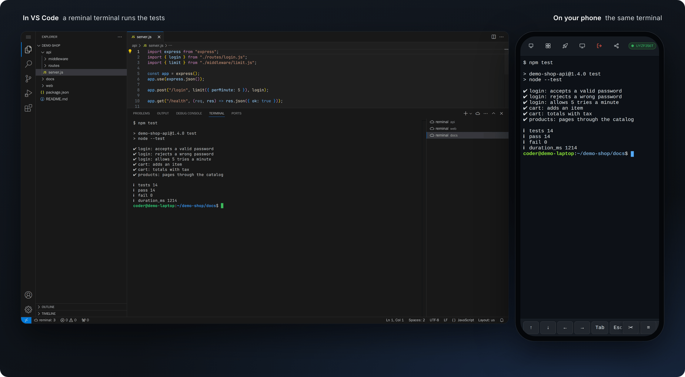
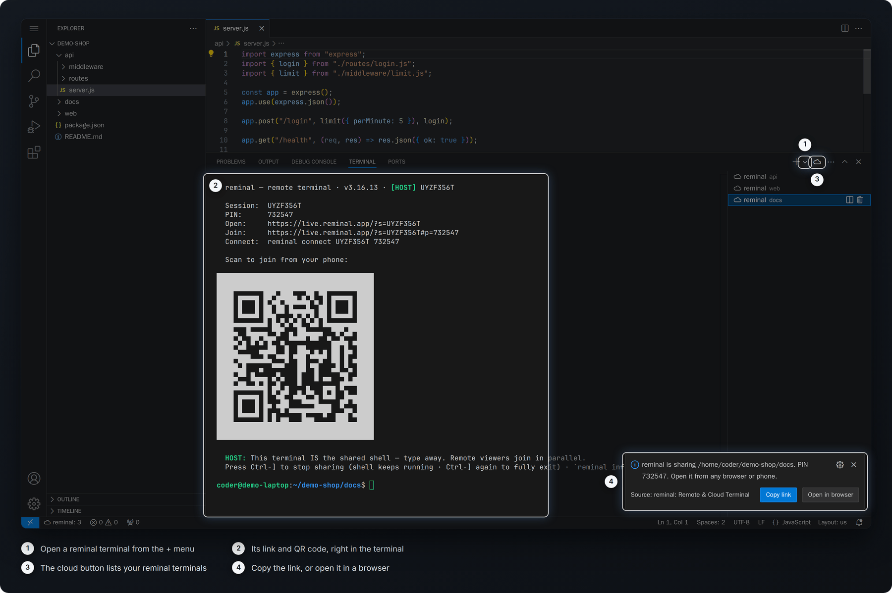
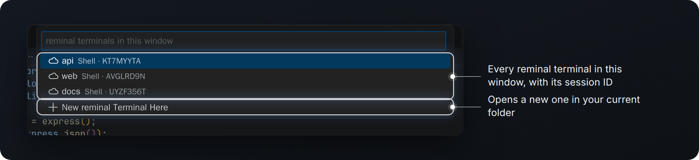
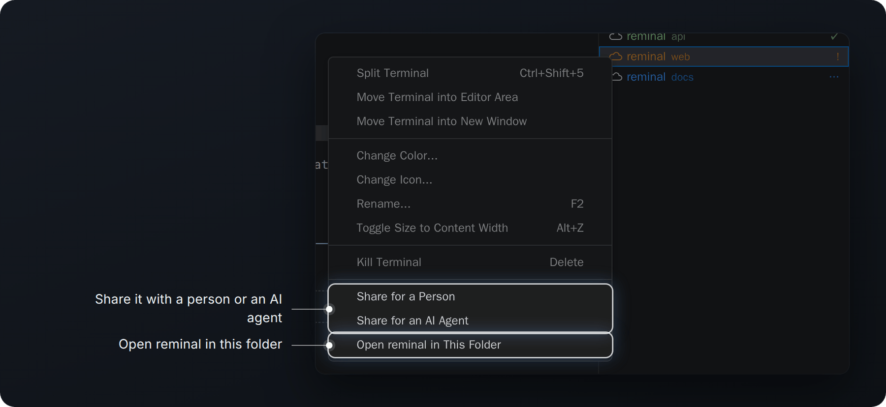
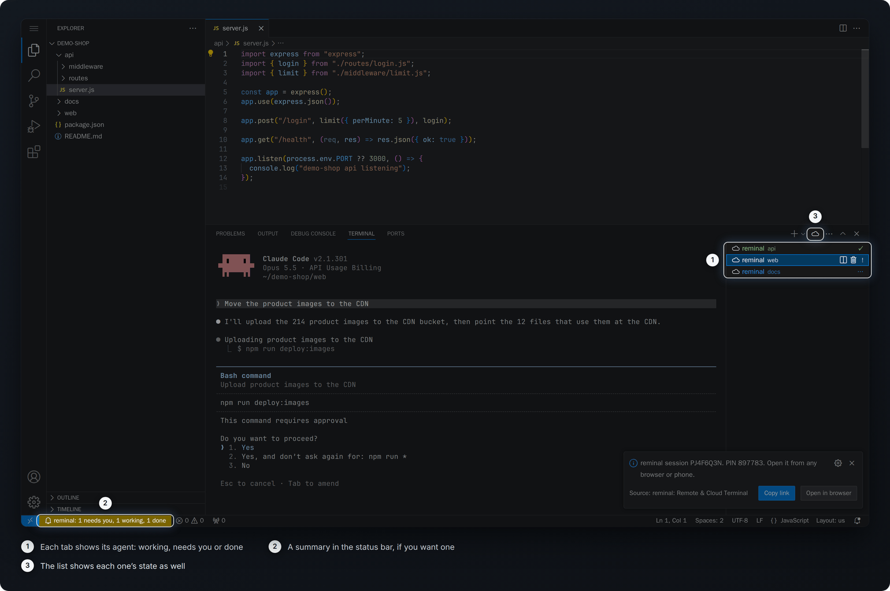

# reminal for VS Code

A remote terminal you can open from your phone or any browser.

reminal makes a VS Code terminal one you can pick up from anywhere. Start a
build or a coding agent at your desk, then follow along, or type into it, from
your phone on the way home. Nothing needs installing on the device in your
hand, and there's no SSH server or port forwarding to set up. Each terminal is
a [reminal](https://reminal.app) session, reached with a link and a PIN.

It works in VS Code, Cursor, Windsurf, VSCodium and code-server.

## In the terminal panel

Choose **reminal** from the menu beside the `+` and the new terminal is shared
from the moment it opens. You can also make it your default profile.

When a reminal terminal starts, a notification shows its PIN with buttons to
copy the link or open it in your browser, and the terminal prints the same
link with a QR code for your phone. **reminal: Show Link for This Terminal**
brings it back later.

The cloud icon in the panel's title bar lists the reminal terminals in the
window and what each one is doing, with a shortcut at the bottom to open a new
one in your current folder.

Right-click a terminal tab for three more actions. **Open reminal in This
Folder** starts a reminal terminal where that one is. VS Code doesn't let an
extension take over a shell that's already running, so this is a fresh shell
in the same folder, and it asks before closing the old one. **Share for a
Person** copies a join link and a `reminal connect` line to send to someone,
and **Share for an AI Agent** copies instructions another agent can follow to
join.

That second one lets agents work together. Paste the instructions into a
second agent's chat and it joins the same live shell, seeing everything the
first one has run and typing alongside it. One agent can review or test what
another has built, take over a task partway through, or keep an eye on a long
job while the first moves on. You can watch it all from your phone.

## Copy files to another machine

Right-click a file or folder in the Explorer and choose **reminal Copy** to
get a one-time code. On the other machine, right-click the folder it should
go in and choose **reminal Paste…**, or run `reminal paste <code>` in any
terminal. The two machines don't need to be on the same network, the code
works once and only for an hour, and a folder arrives just as it was when you
copied it. Something whose name starts with a dot, such as `.ssh`, is pasted
as `pasted-.ssh`, so it never lands as a hidden file or folder.

## Share a port

The cloud button's list also shows the ports you're sharing with
`reminal expose`, ready to copy the link, open it or stop sharing.
**Share a Port…** at the bottom of the list shares another one, such as your
dev server, at a public address that asks for a PIN.

Copying folders and the ports in the list need reminal 3.17.0 or later.

## Know when your agent needs you

When an agent such as Claude Code runs in a reminal terminal, its tab shows how
it's getting on: `…` while it works, `!` when it's waiting for you and `✓` when
it's finished. A notification lets you know the moment one is waiting, and
`reminal.statusBar` adds a summary to the status bar if you'd like one. This
needs reminal 3.16.13 or later.

## Leave it running

reminal keeps your computer awake while a session is open, so work carries on
after you step away. On a Mac you can even close the lid: closed-lid mode
keeps your sessions reachable with the lid shut and nothing plugged in.

    reminal settings closed-lid on

It asks for your admin password, since it changes how the Mac sleeps, and
`reminal settings closed-lid off` restores the usual behavior. Running
unplugged draws on the battery, and a laptop that's still running is best kept
out of a bag.

## More from reminal

The extension is one way into reminal, which does a good deal more once it's
installed.

From any browser you can see and control the windows on your computer, much
like remote desktop but without a VNC client. Sessions outlast the terminal and
the connection, the way tmux does, so you can reconnect from anywhere and find
everything as you left it. Send the link and PIN to a colleague and you're pair
programming in the same shell, with no account needed.

`reminal expose 3000` publishes a local web server at a public address guarded
by a PIN. `reminal copy` and `reminal paste` move a file or folder between two
machines with a one-time code. `reminal machines` lists every computer you own and
what's running on each, and `reminal integrate` gives Claude Code, Codex,
Cursor, Gemini and other agents an MCP server for reading and typing into your
sessions.

Terminal sessions and window mirroring are end-to-end encrypted, nothing needs
an open port, and you're free to run your own relay. Exposed ports are the one
exception to the encryption, because an ordinary browser visits them; the PIN
protects them instead.

## Getting started

The extension needs the reminal program. On macOS or Linux:

    curl -fsSL https://reminal.app/install.sh | sh

On Windows, in PowerShell:

    irm https://reminal.app/install.ps1 | iex

If it isn't installed yet, the extension offers to install it for you in a
terminal, where you can answer the installer's questions, and opens a reminal
terminal once it's done. It finds reminal on your PATH or wherever the
installer put it, even when the editor was launched from the Dock or the Start
menu.

## Settings

| Setting | Default | What it does |
| --- | --- | --- |
| `reminal.path` | empty | Full path to `reminal`, if it lives somewhere unusual. Read from user settings only |
| `reminal.showLinkOnStart` | `true` | Show the link notification when a reminal terminal starts |
| `reminal.closeOriginal` | `ask` | After Open reminal in This Folder: `ask`, `always` close the old terminal, or `never` |
| `reminal.notifyNeedsYou` | `true` | Let you know when a reminal terminal starts waiting for you |
| `reminal.statusBar` | `false` | Also sum up every reminal terminal's status in the status bar |

## Good to know

- In a remote window (Remote SSH, Dev Containers, code-server), reminal runs on
  the remote machine, so install it there.
- The badges appear in the terminal tab list and on terminals in the editor
  area. VS Code doesn't draw them in the compact header it uses when only one
  terminal is open, or while its own icon, such as the warning after a reload,
  is on the tab.
- The Share items appear on every terminal tab while any reminal terminal is
  open, since VS Code doesn't tell an extension which tab was clicked. On an
  ordinary terminal they offer to open a reminal one instead.

## License

AGPL-3.0-or-later, like the rest of reminal.
